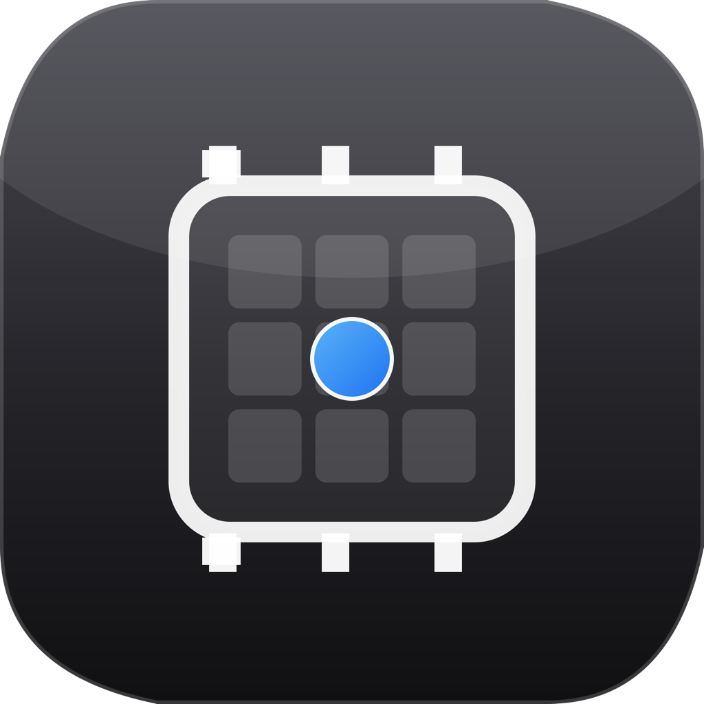

# GPU Monitor

macOS 菜单栏常驻性能监控，实时显示 GPU / CPU / 内存 / 网络 / 温度，适合本地跑大模型时观察机器状态。



## 特性

- 菜单栏四合一摘要：内存占用、下载速度、GPU 利用率、温度
- 弹出面板：GPU / CPU / 内存 / Swap / 网络 / 告警 / 趋势图
- 动态配色、告警通知、历史趋势、数据导出（CSV/JSON）
- **纯原生采集**：IORegistry、Mach、SMC、netstat；无 macmon 等外部 CLI
- 轻量：.app 约 2 MB，DMG 约 2.5 MB

## 系统要求

- macOS 14+（Apple Silicon）
- 无需 root、无需辅助功能权限

## 构建

```bash
swift build
bash scripts/build.sh
```

生成 `GPUMonitor.app` 与 `GPUMonitor.dmg`。

## 数据来源

| 指标 | 来源 |
| --- | --- |
| GPU 利用率 | IORegistry `AGXAccelerator` |
| CPU 利用率 | Mach `host_processor_info` |
| 内存 / Swap | Mach `host_statistics64` + sysctl |
| CPU / GPU 温度 | SMC（`CSMCBridge`），回退 IOHID |
| 网络速率 | `netstat -ib` 差分 |

`CSMCBridge` 的 SMC 只读逻辑参考自 [macmon](https://github.com/vladkens/macmon) 与 [MacMonitor](https://github.com/ryyansafar/MacMonitor)，均为 MIT 协议，详见 [THIRD_PARTY_NOTICES.md](THIRD_PARTY_NOTICES.md)。

## 协议

MIT
